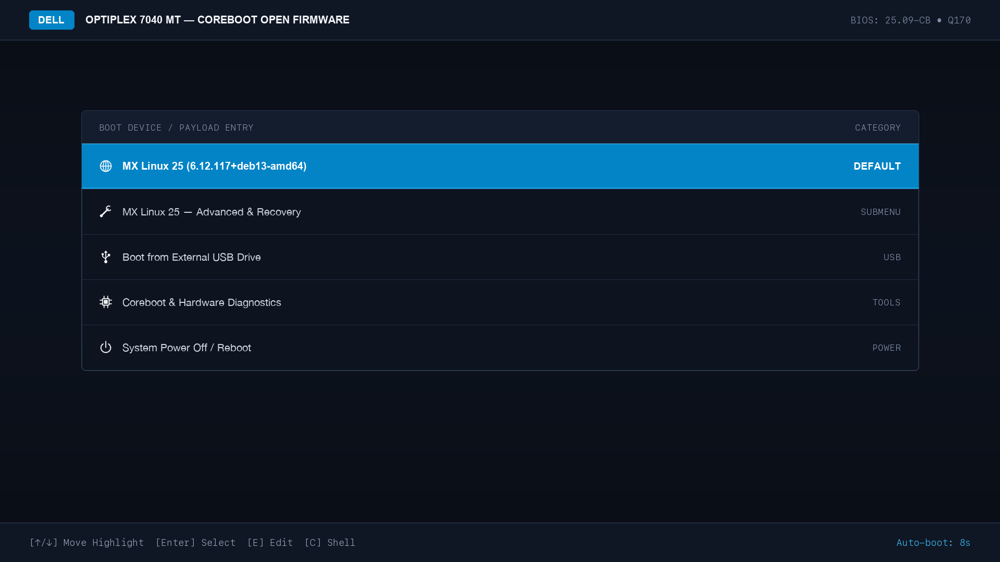

# Coreboot for Dell OptiPlex 7040 MT (`sklkbl_desktops/optiplex_7040`)

Open-source Coreboot + GRUB 2.14 firmware port for the Dell OptiPlex 7040 Mini Tower (MT) (Intel Skylake Q170 PCH, LGA1151), including **`Workstation-Bootmenu-Sample`** which is simply a proof-of-concept `1920×1080` `gfxmenu` theme demonstrating that an embedded Coreboot + GRUB2 payload can have a clean, modern workstation boot UI. With some help from locally hosted and frontier artificial intelligence combined, it is proven that it is possible to port Coreboot, and perhaps even Libreboot, to somewhat newer machines (~2015). There is some work left to be done by way of reverse-engineering the proprietary blobs that are still necessary to run this firmware image. I run this image on my OptiPlex 7040 that I actually own and it works very well.



---

## Repository Layout

This repository contains only the custom board port, payload patches, sample boot menu theme, and hardware reverse-engineering documentation.

| Directory / File                                                                                                                                                              | What is this?                                                                                                                                                                                                                                                                                                                                                                                 |
|:----------------------------------------------------------------------------------------------------------------------------------------------------------------------------- |:--------------------------------------------------------------------------------------------------------------------------------------------------------------------------------------------------------------------------------------------------------------------------------------------------------------------------------------------------------------------------------------------- |
| [`board/src/mainboard/dell/sklkbl_desktops/Kconfig`](board/src/mainboard/dell/sklkbl_desktops/Kconfig)                                                                        | Adds `BOARD_DELL_OPTIPLEX_7040` (`OptiPlex 7040 MT`) to Dell Skylake/Kaby Lake desktops (`TPM1`, `IFD_GBE`, `DDI_E_BIFURCATION`, `DIMM_SPD_SIZE=512`).                                                                                                                                                                                                                                        |
| [`board/.../variants/optiplex_7040/overridetree.cb`](board/src/mainboard/dell/sklkbl_desktops/variants/optiplex_7040/overridetree.cb)                                         | Hardware topology derived from live probing: PEG x16 (`SLOT2`), M.2 NVMe x4 on `pcie_rp17` (`SRCCLKREQ2#`), TI XIO2001 PCI bridge on `pcie_rp1` (`SLOT3`), PCIe x1 on `pcie_rp7` (`SLOT1`), PCIe x4 on `pcie_rp9` (`SLOT4`), measured 10× USB2 + 6× USB3 port/OC map, SATA ports `0..3`, LPC generic decodes (`0x680`, `0x900`, `0x7e0`, `0xa00`), SMSC SCH5555 8042, and TPM 1.2 (`0c31.0`). |
| [`board/.../variants/optiplex_7040/romstage.c`](board/src/mainboard/dell/sklkbl_desktops/variants/optiplex_7040/romstage.c)                                                   | Configures FSP-M for 4× DDR4 UDIMM slots (`0x50..0x53`) with `DqPinsInterleaved = true`.                                                                                                                                                                                                                                                                                                      |
| [`board/.../variants/optiplex_7040/early_gpio.c`](board/src/mainboard/dell/sklkbl_desktops/variants/optiplex_7040/early_gpio.c)                                               | Configures `GPP_C0/C1` (`SMBCLK`/`SMBDATA`) before SPD read and parks unused PCH `UART0` (`GPP_C8/C9`); serial console runs on the SMSC SCH5555 LPC UART at `0x3f8`.                                                                                                                                                                                                                          |
| [`board/.../variants/optiplex_7040/gpio.c`](board/src/mainboard/dell/sklkbl_desktops/variants/optiplex_7040/gpio.c)                                                           | Complete 197-pad Sunrise Point-H GPIO configuration reconstructed and audited against the OEM firmware (`docs/hardware-probing/pad_analysis.txt`).                                                                                                                                                                                                                                            |
| [`board/.../variants/optiplex_7040/gma-mainboard.ads`](board/src/mainboard/dell/sklkbl_desktops/variants/optiplex_7040/gma-mainboard.ads)                                     | Native `libgfxinit` display initialization for rear HDMI (`DDI B`) and dual DisplayPort++ (`DDI C`, `DDI D`), plus `data.vbt` + `DDI E` bifurcation for the optional VGA daughterboard.                                                                                                                                                                                                       |
| [`board/.../variants/optiplex_7040/hda_verb.c`](board/src/mainboard/dell/sklkbl_desktops/variants/optiplex_7040/hda_verb.c)                                                   | Extracted OEM Azalia verb tables for Realtek ALC3234 (`0x10ec0255`, subsystem `0x102806b9` — internal speaker, front headset jack, rear line-out) and Intel Skylake HDMI audio (`0x80862809`).                                                                                                                                                                                                |
| [`patches/0002-payloads-GRUB2-Fix-binutils-2.46-image-base-and-PHONY.patch`](patches/0002-payloads-GRUB2-Fix-binutils-2.46-image-base-and-PHONY.patch)                        | Fixes GRUB 2.14 + GNU Binutils 2.46.1 (`i386-elf-ld`) selecting `-Wl,--image-base,0x9000` (which shifts `.text` by `0x54` ELF header bytes to `0x9054`) by forcing `TARGET_IMG_BASE_LDOPT="-Wl,-Ttext"`, and marks `grub2` `.PHONY` under Coreboot's `.SECONDARY:` rule.                                                                                                                      |
| [`theme/Workstation-Bootmenu-Sample/`](theme/Workstation-Bootmenu-Sample/) & [`theme/generate_workstation_bootmenu_sample.py`](theme/generate_workstation_bootmenu_sample.py) | **`Workstation-Bootmenu-Sample`** proof-of-concept `1920×1080` GRUB2 `gfxmenu` theme (`background.png`, 9-slice selection bars, anti-aliased icons, `.pf2` fonts with pixel-aligned category spacers) and [`configs/grub_payload.cfg`](configs/grub_payload.cfg).                                                                                                                             |
| [`docs/verify_and_build.py`](docs/verify_and_build.py)                                                                                                                        | Automated build & cryptographic/structural flash-safety verification suite.                                                                                                                                                                                                                                                                                                                   |
| [`docs/hardware-probing/`](docs/hardware-probing/)                                                                                                                            | Raw text dumps (`ifd_dump.txt`, `inteltool_gpio_7040.txt`, `superiotool_7040.txt`, `pad_analysis.txt`) and Python analysis scripts used during board bring-up.                                                                                                                                                                                                                                |

---

## Hardware Support Status

| Subsystem           | Controller / IC                                                                       | Status                                             |
|:------------------- |:------------------------------------------------------------------------------------- |:-------------------------------------------------- |
| **CPU & Chipset**   | Intel Skylake-S (i5-6500 / i7-6700) + Intel Q170 PCH (Sunrise Point-H)                | Working (Microcode `06-5e-03`, `06-9e-09` via FIT) |
| **Memory**          | 4× DDR4 UDIMM (`0x50..0x53`, up to 64 GiB)                                            | Working (FSP-M + MRC cache)                        |
| **Graphics**        | Intel HD Graphics 530 (`libgfxinit` linear framebuffer `1920×1080 cbfb`)              | Working (HDMI1, DP1, DP2; VGA via OS i915 + VBT)   |
| **Storage**         | M.2 2280 NVMe (`pcie_rp17` x4) + 4× SATA 6Gb/s (`ports 0..3`)                         | Working (Bootable in GRUB2 & Linux)                |
| **Expansion Slots** | `SLOT1` (PCIe x1), `SLOT2` (PEG x16), `SLOT3` (PCI via TI XIO2001), `SLOT4` (PCIe x4) | Working                                            |
| **Networking**      | Intel I219-LM Gigabit Ethernet (`00:1f.6`)                                            | Working (Preserves factory MAC in `SI_GBE`)        |
| **USB**             | 6× USB 3.0 (2 front, 4 rear) + 4× USB 2.0 (2 front, 2 rear) + 2× internal             | Working (Verified port & OC mapping)               |
| **Audio**           | Realtek ALC3234 (`10ec:0255`) + Intel HDMI Audio (`8086:2809`)                        | Working (Internal speaker, front & rear jacks)     |
| **SuperIO / UART**  | SMSC SCH5555 (`2e`) — 16550A Serial Console on `COM1` (`0x3f8`, `115200n8`) + PS/2    | Working                                            |
| **Intel ME**        | Intel CSE / Management Engine 11.x                                                    | Working (Neutralized via `deguard` + IFD HAP bit)  |

---

## SPI Flash Chip Pinout & External Flashing Guide (`MX25L12805D`)

### Hardware & Security Facts

* **Flash IC**: **Macronix `MX25L12805D`** **16 MB (128 Mbit)**, **SOIC-8 (208-mil)**, **3.3 V**, **JEDEC ID `0xC2 0x20 0x18`**.
  * *(Note: The Intel Flash Descriptor VSCC table is multi-source and also permits 16 MB 3.3 V SOIC-8 parts from Winbond [`0xEF 0x60 0x18`], GigaDevice [`0xC8 0x40 0x18`], and Micron [`0x20 0xBA 0x18`]; all share the identical 25-series SOIC-8 pinout below.)*
* **Intel Boot Guard (Fused Active)**: Confirmed via `MSR 0x13A = 0x30000007b` and `HFSTS6` in **Verified + Measured** profile. Neutralizing Intel ME `v11.8` withCoreboot's [`deguard`](https://review.coreboot.org/plugins/gitiles/deguard) utility + the IFD HAP bit is mandatory; an unmodified or purely `me_cleaner`-truncated ME will fail Boot Guard verification.
* **Stock Firmware Locks**: Under the factory Dell BIOS, internal writes are blocked by SMM write protection (`BIOS_CNTL = 0x8b`), SPI configuration lockdown, and locked Flash Descriptor permissions (`FLMSTR`). Additionally, the ME region (`0x003000–0x6FFFFF`) is read-locked internally (reads back all zeros), so **your backup must be captured externally with a 3.3 V SOIC-8 clip**.
* **Exact 16 MB SPI Region Map (`ifdtool`)**:
  * `0x000000–0x000FFF` (`4 KiB`): `SI_DESC` — Flash Descriptor
  * `0x001000–0x002FFF` (`8 KiB`): `SI_GBE` — Intel I219-LM Gigabit Ethernet NVRAM (contains MAC address)
  * `0x003000–0x6FFFFF` (`7,156 KiB`): `SI_ME` — Intel Management Engine (locked under OEM BIOS)
  * `0x700000–0xFFFFFF` (`9,216 KiB`): `BIOS` — Coreboot (`RW_MRC_CACHE` + `COREBOOT` CBFS + `bootblock`)

### `MX25L12805D` SOIC-8 Package Pinout (Top View)

```text
               Macronix MX25L12805D (SOIC-8, 3.3 V, 16 MB)
                       JEDEC ID: 0xC2 0x20 0x18
                            +-----------+
              /CS (CS#)  ---| 1   ●   8 |--- VCC (+3.3 V)
         DO / IO1 (MISO) ---| 2       7 |--- /HOLD (HOLD# / IO3)
         /WP (WP# / IO2) ---| 3       6 |--- SCLK (CLK)
              GND (VSS)  ---| 4       5 |--- DI / IO0 (MOSI)
                            +-----------+
                    (● = Pin 1 bevel / dot indicator)
```

### Pin-by-Pin Programmer Wiring Table

> **Warning: 3.3 V Logic Only!** Never apply 5 V to `VCC` or any data pin. Disconnect AC power from the OptiPlex 7040 MT PSU before attaching the SOIC-8 clip.

| Pin   | Symbol                    | Function                      | Programmer Connection (CH341A 25xx / RPi SPI0 / Generic)                     |
|:-----:|:------------------------- |:----------------------------- |:---------------------------------------------------------------------------- |
| **1** | `/CS` (`CS#`)             | Chip Select (Active Low)      | `CS` / `CE0` (RPi Pin 24 / `GPIO8`)                                          |
| **2** | `DO` (`SO` / `IO1`)       | Serial Data Output (**MISO**) | `MISO` / `DO` (RPi Pin 21 / `GPIO9`)                                         |
| **3** | `/WP` (`WP#` / `IO2`)     | Write Protect (Active Low)    | Tie to **+3.3 V (`VCC`)** *(prevents accidental hardware write-protect)*     |
| **4** | `GND` (`VSS`)             | Ground                        | `GND` (RPi Pin 25)                                                           |
| **5** | `DI` (`SI` / `IO0`)       | Serial Data Input (**MOSI**)  | `MOSI` / `DI` (RPi Pin 19 / `GPIO10`)                                        |
| **6** | `SCLK` (`CLK`)            | Serial Clock                  | `SCLK` / `CLK` (RPi Pin 23 / `GPIO11`)                                       |
| **7** | `/HOLD` (`HOLD#` / `IO3`) | Hold Input (Active Low)       | Tie to **+3.3 V (`VCC`)** *(prevents floating bus pauses during read/write)* |
| **8** | `VCC`                     | Power Supply (**+3.3 V**)     | **+3.3 V** (RPi Pin 1 / Regulated 3.3 V supply)                              |

### Capturing the Backup (Before First Flash)

Always take **three** full 16 MB reads over the SOIC-8 clip and confirm their SHA-256 hashes match before erasing or writing. This ensures image consistency just in case.

```bash
flashrom -p <your_external_programmer> -c "MX25L12805D" -r xyz1.rom
flashrom -p <your_external_programmer> -c "MX25L12805D" -r xyz2.rom
flashrom -p <your_external_programmer> -c "MX25L12805D" -r xyz3.rom
sha256sum xyz1.rom xyz2.rom xyz3.rom
```

---

## Building & Verifying the Firmware Image

### 1. Prepare Upstream Coreboot (`bd50f395`)

```bash
git clone https://review.coreboot.org/coreboot.git
cd coreboot
git checkout bd50f395
git submodule update --init --checkout
make crossgcc-i386 CPUS=$(nproc)
```

### 2. Apply This Repository's Overlay & Patches

```bash
./apply_to_coreboot.sh /path/to/coreboot
```

### 3. Provide Board-Specific Blobs

Extract the following from your own backup dump (`flashrom -p internal -r xyz.rom`) using `ifdtool -x golden.rom` and [`deguard`](https://review.coreboot.org/plugins/gitiles/deguard):

* `blobs/ifd_hap.bin` (`0x000000..0x000fff` with HAP bit set via `ifdtool -p sklkbl -M 1`)
* `blobs/flashregion_3_gbe.bin` (`0x001000..0x002fff` — preserves your unit's MAC address)
* `me_deguard_7040.bin` (`1,118,208`-byte deguarded ME image for Q170 SKU)

The reverse engineering for these binaries is yet to be done, but could possibly be completed soon.

### 4. Build `Workstation-Bootmenu-Sample` Theme, Compile ROM, and Verify Safety

```bash
python3 docs/verify_and_build.py
```

This script generates the `1920×1080` **`Workstation-Bootmenu-Sample`** theme and `.pf2` fonts, compiles `default_payload.elf` and `coreboot.rom`, and verifies all 11 structural and cryptographic invariants.

### 5. Flashing

* **Initial Flash (from OEM Dell BIOS, external 3.3 V SOIC-8 clip required):**

  ```bash
  flashrom -p <your_external_programmer> -c "MX25L12805D" -w cb_workstation_bootmenu_sample.rom
  ```

* **Subsequent Updates (once running Coreboot with unlocked IFD):**

  ```bash
  sudo flashrom -p internal -w cb_workstation_bootmenu_sample.rom
  ```
